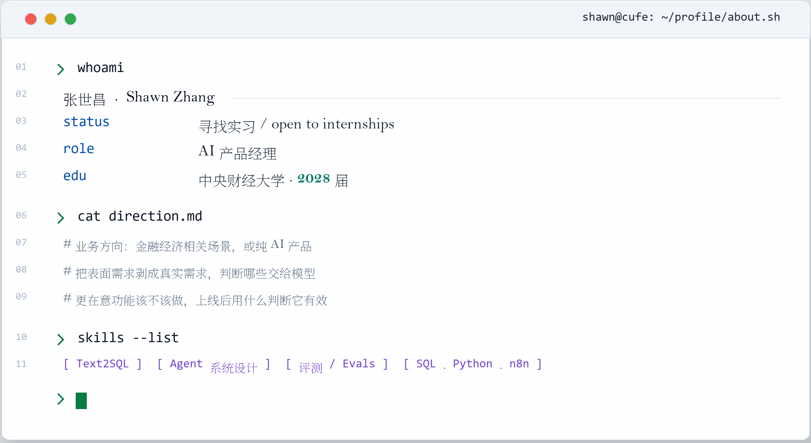
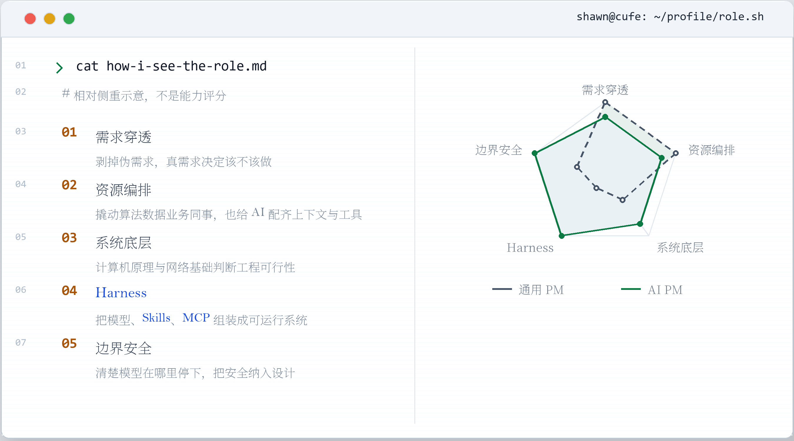
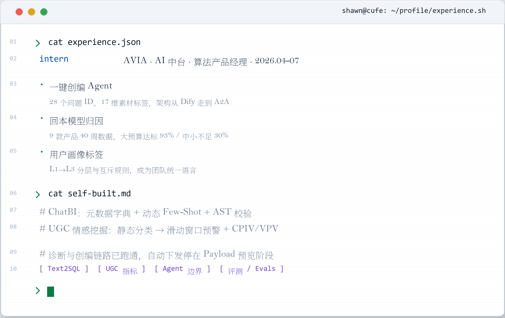
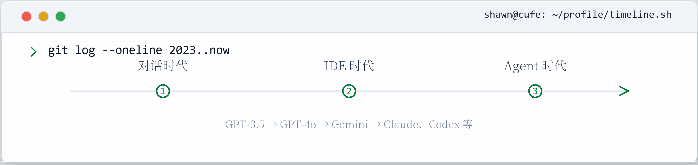
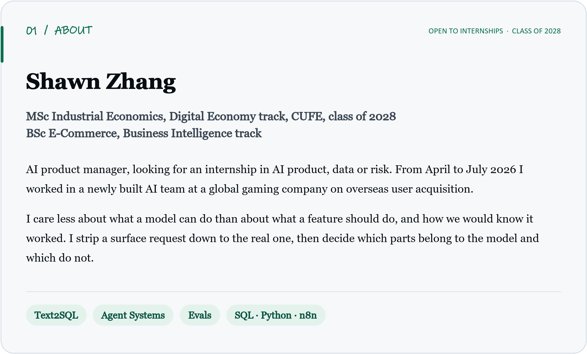
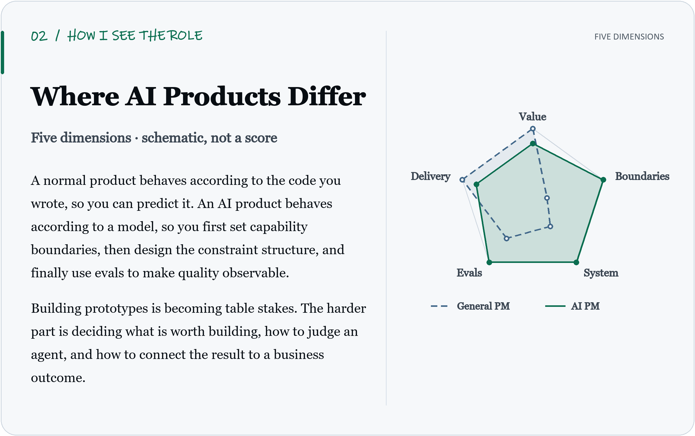
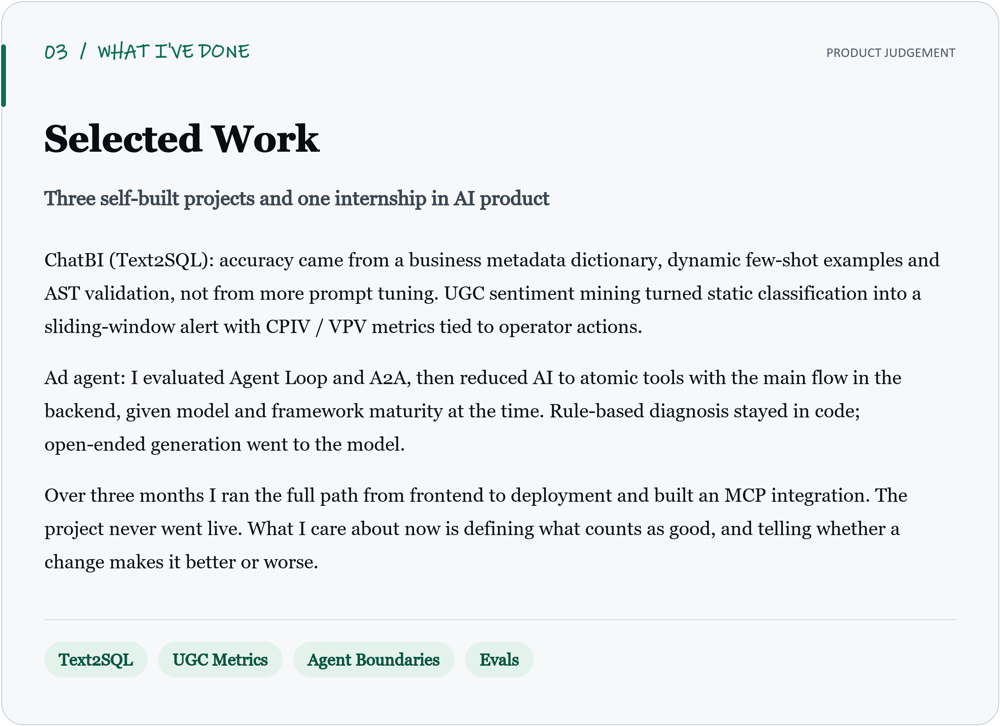
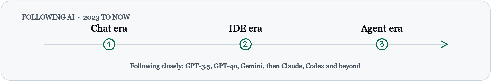

默认显示中文版 · <strong>English version</strong> 在最下方，点击展开

  

<picture>
  <source media="(prefers-color-scheme: dark)" srcset="assets/block-01-dark.png">
  
</picture>

<picture>
  <source media="(prefers-color-scheme: dark)" srcset="assets/block-02-dark.png">
  
</picture>

<picture>
  <source media="(prefers-color-scheme: dark)" srcset="assets/block-03-dark.png">
  
</picture>

## 📦 公开的 skills 仓库

三个给 AI agent 用的技能仓库，和上面的产品工作是两条线：

| 仓库 | 一句话 |
| --- | --- |
| [**academic-tikz**](https://github.com/Eastr5/academic-tikz) | 📐 论文级 TikZ / PGFPlots 绘图技能包，187 个模板全部真实编译过——编译不过的活该被删 |
| [**literature-access-skills**](https://github.com/Eastr5/literature-access-skills) | 📚 文献检索 → 按 DOI 批量下全文 → 进 Zotero，一条链跑通，不人肉搬运 |
| [**skill-router-v3**](https://github.com/Eastr5/skill-router-v3) | 🔀 给 AI coding agent 用的 MCP / Skill / Tool 路由器，跨 Trae / Claude / Cursor / VSCode |
| [**github-profile-blocks**](https://github.com/Eastr5/github-profile-blocks) | 🧩 把主页 README 画成深浅双主题设计卡片的 WorkBuddy skill，含手绘雷达 / 时间线与一键推送 |

## 🎵 平时

- 爱好：Hip-hop 音乐。
- 特殊爱好：和 AI 对话。2023 年左右 ChatGPT 3.5 出现时就开始保持对话，也一直关注前沿模型，从 3.5 到 4o，再到 Gemini，再到现在的 Claude、Codex 等；经历了对话时代、IDE 时代，再到 Agent 时代，算是自己对 AI 发展的一段刻画。

<picture>
  <source media="(prefers-color-scheme: dark)" srcset="assets/ai-timeline-dark.png">
  
</picture>

## 📫 联系

`2026212853@email.cufe.edu.cn` · WeChat: `eastr5`

纯文本版（便于复制、检索与朗读）

中央财经大学电子商务本科（商务智能方向），校内推免至产业经济学硕士（数字经济方向，2028 届）。目标岗位是 AI 产品经理，业务方向希望是金融经济相关场景，或者纯 AI 产品，两者都在考虑。

2026 年 4–7 月在 AVIA（AviaGames，美资手游公司）AI 中台做算法产品经理，负责海外投放。我把这份工作理解成两件事：把表面需求剥成真实需求，以及判断哪些交给模型、哪些不交——动手搭东西是探边界的手段，不是目的。自己也从 0 到 1 做过 Text2SQL 取数产品和 UGC 商业价值指标体系。

写需求文档、定边界、设计评测口径的时间比写代码多。SQL / Python / n8n 是常用工具，但更在意一个功能该不该做、上线后用什么判断它有效；技术原理上更关心它能不能翻译成决策，比如质量、成本、延迟怎么权衡。

把 AI 产品经理的工作拆成五个维度，看的不是能力高低，是侧重往哪里迁移：需求穿透、资源编排、系统底层、Harness、边界安全。需求要先被拆开，识别并剥掉伪需求，剩下的真需求才决定这件事该不该做；资源也不只是撬动算法、数据与业务同事，还包括给 AI 配齐上下文、工具、数据和权限，这一层是传统产品工作里没有的。计算机底层原理与网络基础决定方案在工程上站不站得住，Harness 从原理到架构的认知决定能不能把模型、Skills、MCP 和工具链组装成可运行的系统；最后收在边界上，清楚模型在哪里停下来，并把安全范畴一并纳入设计。通用产品经理的侧重更多落在前两维，AI 产品经理更多落在后三维。雷达画的是相对侧重，不是能力测评或个人评分。

### 自建项目

| 项目 | 要解决的问题 | 关键取舍 |
| --- | --- | --- |
| **ChatBI**（Text2SQL） | 中小商家做数据分析要依赖专业人员 | 准确率不能只靠 Prompt，所以做了业务元数据字典 + 动态 Few-Shot + AST 校验三层风控，而不是继续调提示词 |
| **UGC 情感挖掘** | 评论里的负面信号发现得太晚 | 把静态分类做成滑动时间窗口的预警，并自研 CPIV / VPV 指标，让结果能直接对应到运营动作 |
| **销售预测与库存预警** | 「断货」和「滞销」同时存在 | 用 WRMSSE 替代通用误差指标，让模型优化方向和财务风险对齐 |

### AVIA 实习（AI 中台 · 算法产品经理）

2026 年 4–7 月在 AVIA（AviaGames）AI 中台实习，业务线是海外投放。下面只写方法层面的判断，不涉及公司内部数据。

三条工作线各自留下的结果：一键创编 Agent 沉淀了 28 个问题 ID 与 17 维素材标签，推动架构从 Dify 演进到 A2A；回本模型准度归因覆盖 9 款产品 40 周数据，量出大预算产品 K15/6 达标 93%、中小预算不足 30%，并附五层归因框架与参考 SQL；用户画像标签体系做了 L1 到 L3 分层与互斥规则，成了团队的统一语言。

- **技术选型是一次边界判断。** 评估过 Agent Loop 和 A2A，基于当时的模型能力和框架成熟度，选择把 AI 降成原子化 Tools、主流程交给后端；诊断按规则检查用代码控流程，创编要路由到不同解法才交给模型。这是约束下的取舍，不是「AI 做不到」。
- **会搭原型正在变成基本功。** Cursor 这类工具把搭建门槛降给了所有人，更难的是决定什么值得搭、怎么判断 Agent 好不好用、能不能把东西推到业务结果上。
- **Prompt 是产品契约。** 输入数据契约、输出格式、枚举含义、异常边界、执行前自检，这一层和写 PRD 是同一件事；领域知识再拆成按场景加载的 Skills，避免把所有规则塞进一条长提示词。
- **怎么定义「好」。** 建测试集、判断一次改动是变好还是变差，是 AI 产品和普通产品最不一样的地方。我现在更愿意把精力放在这上面，而不是多搭一个原型。
- **边界要写进文档。** 系统负责生成方案，投手是 Operator；诊断与创编链路已跑通，自动下发还停在 Payload 预览与 mock 阶段，对外演示不暗示「一键上量」。这不是项目失败，是当时明确的交付边界。

另一条线是面向海外用户的分层行为标签体系：拉了算法、产品、数据三方同学共建，业务上涉及身份核验与风控场景；以及向数据科学团队提归因需求时，先给分层框架和参考 SQL，而不是只丢一个问题过去。

爱好：Hip-hop 音乐。特殊爱好：和 AI 对话。2023 年左右 ChatGPT 3.5 出现时就开始保持对话，持续关注前沿模型，从 3.5 到 4o 再到 Gemini，再到现在的 Claude、Codex 等；经历了对话时代、IDE 时代，再到 Agent 时代，算是自己对 AI 发展的一段刻画。

---

2023 年开始和 AI 对话，现在还在和它对话—— 只是问题从「你能做什么」变成了 <strong>「这件事该不该交给你」</strong>。

---

<strong>English version</strong> · 点击展开 / click to expand

<picture>
  <source media="(prefers-color-scheme: dark)" srcset="assets/block-01-en-dark.png">
  
</picture>

<picture>
  <source media="(prefers-color-scheme: dark)" srcset="assets/block-02-en-dark.png">
  
</picture>

<picture>
  <source media="(prefers-color-scheme: dark)" srcset="assets/block-03-en-dark.png">
  
</picture>

## Public skill repositories

Four skill repos for AI coding agents. This is a separate line of work from the product roles above.

| Repo | One line |
| --- | --- |
| [**academic-tikz**](https://github.com/Eastr5/academic-tikz) | Publication-grade TikZ / PGFPlots diagram skills, 187 templates, every one actually compiled |
| [**literature-access-skills**](https://github.com/Eastr5/literature-access-skills) | Literature search to bulk full-text download by DOI into Zotero, one chain, no manual copying |
| [**skill-router-v3**](https://github.com/Eastr5/skill-router-v3) | MCP / Skill / Tool router for AI coding agents, works across Trae, Claude, Cursor and VSCode |
| [**github-profile-blocks**](https://github.com/Eastr5/github-profile-blocks) | A WorkBuddy skill that draws this profile README as light/dark design cards, with hand-drawn radar and timeline |

## Off hours

- Hip-hop.
- A long-running conversation with AI. I started around GPT-3.5 in 2023 and have followed frontier models since, from 4o to Gemini to today's Claude and Codex. Chat era, IDE era, Agent era: it doubles as a small map of how I got here.

<picture>
  <source media="(prefers-color-scheme: dark)" srcset="assets/ai-timeline-en-dark.png">
  
</picture>

## Contact

`2026212853@email.cufe.edu.cn` · WeChat: `eastr5` · [Portfolio and writing](https://eastr5.github.io/blog/)

### Plain text version (for copy, search and screen readers)

I hold a BSc in E-Commerce (Business Intelligence track) from the Central University of Finance and Economics, and was recommended into the MSc in Industrial Economics, Digital Economy track, graduating in 2028. I am aiming at AI product manager roles, with a preference for finance and economics related products or for pure AI products; both are open.

From April to July 2026 I was an algorithm product manager on the AI platform team at AVIA (AviaGames), a US-funded mobile games company, on overseas user acquisition. I see that job as two things: stripping a surface request down to the real one, and deciding which parts belong to the model and which do not. Building things is how I probe the boundary, not the point of the job. I have also built a Text2SQL data product and a UGC commercial value metric system from zero.

I spend more time writing requirements, setting boundaries and designing evaluation criteria than writing code. SQL, Python and n8n are my everyday tools, but I care more about whether a feature should exist and how we will tell if it worked. On technical questions I care most about whether something can be translated into a decision, for example how to trade off quality, cost and latency.

Split into five dimensions, the point is not who is stronger but where the emphasis moves: true needs, resourcing, systems fundamentals, harness, and boundaries. A request has to be taken apart first, stripping away the stated requirement to find the real one, because that decides whether the feature should exist. Resourcing now means two things: aligning algorithm, data and business colleagues, and equipping the AI itself with the right context, tools, data and permissions, which traditional product work did not require. Computer systems and networking fundamentals determine whether a design holds up in engineering; a full view of the AI harness from principles to architecture determines whether models, skills, MCP and tools can be assembled into something that runs. It closes at the boundary: knowing where the model stops and bringing the safety envelope into the design. A general PM puts more weight on the first two dimensions, an AI PM on the last three. The radar is a sketch of relative emphasis, not a capability assessment or a personal score.

### Self-built projects

| Project | Problem | Key tradeoff |
| --- | --- | --- |
| **ChatBI** (Text2SQL) | Small merchants need analysts to run data queries | Accuracy cannot come from prompts alone, so I built three layers of control: a business metadata dictionary, dynamic few-shot examples and AST validation, instead of tuning the prompt further |
| **UGC sentiment mining** | Negative signals in reviews surface too late | Turned static classification into a sliding time-window alert, and designed CPIV / VPV metrics so the result maps onto an operator action |
| **Sales forecast and stockout alert** | Stockouts and overstock happen at the same time | Used WRMSSE instead of a generic error metric so the model's optimisation direction matches financial risk |

### AVIA internship (AI platform team, algorithm product manager)

The business line was overseas user acquisition. What follows is about method only and contains no internal company data.

Three work streams and what each left behind: a creative Agent with 28 standard problem IDs and a 17-dimension creative tag system, with the architecture moving from Dify to A2A; a payback model attribution study covering 9 products over 40 weeks, showing 93% accuracy on large-budget products and under 30% on smaller ones, delivered with a five-layer framework and reference SQL; and a user profile tagging system with an L1 to L3 hierarchy and mutual exclusion rules that became the shared vocabulary of the team.

- **Technical selection is a boundary decision.** I evaluated Agent Loop and A2A, and given model capability and framework maturity at the time, chose to reduce AI to atomic tools with the main flow in the backend. Rule-based diagnosis stayed in code; open-ended generation, which needed routing between different solutions, went to the model. That was a tradeoff under constraints, not a claim that AI could not do it.
- **Building a prototype is becoming table stakes.** Tools like Cursor have lowered that barrier for everyone. What is harder is deciding what is worth building, how to judge whether an agent is any good, and how to carry the result through to a business outcome.
- **A prompt is a product contract.** Input data contracts, output format, enum meanings, exception boundaries, self checks before execution: this layer is the same job as writing a PRD. Domain knowledge is then split into scenario-loaded skills rather than stuffed into one long prompt.
- **Defining "good".** Building a test set and telling whether a change made things better or worse is the biggest difference between AI products and normal ones. I would rather put my time here than build one more prototype.
- **Boundaries belong in the document.** The system generates plans; the media buyer is the operator. Diagnosis and creative generation chains are live, while automated delivery is still at payload preview and mock stage. No demo should imply one-click scaling. That is a delivery boundary, not a failed project.

A second line of work was a layered behavioural tagging system for overseas users, built jointly with algorithm, product and data colleagues, involving identity verification and risk scenarios. When I raised attribution requirements with the data science team, I brought a layered framework and reference SQL rather than just a question.

Off hours: hip-hop, and a long-running conversation with AI that started around GPT-3.5 in 2023.

I started talking to AI in 2023 and still do. The question changed from <strong>"what can you do"</strong> to <strong>"should this be yours to do"</strong>.

