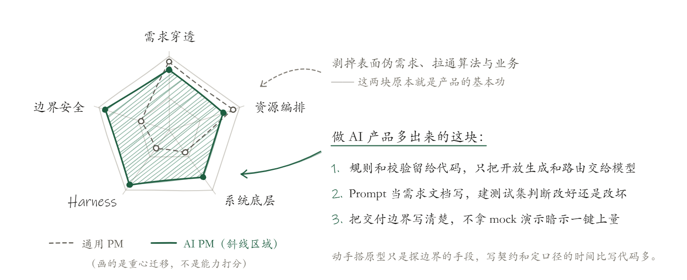
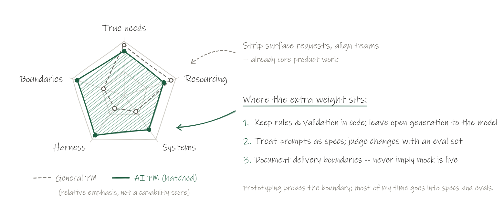

# 张世昌 · Shawn Zhang

中央财经大学产业经济学在读（2028 届，数字经济方向），本科商务智能推免。目前在找 AI 产品经理实习，偏好金融经济相关场景或纯 AI 产品。

平时把和 AI 讨论后留下的想法记在 [个人博客](https://eastr5.github.io/blog/)，也会顺手写几个零安装的 agent 小工具。底部可展开英文版。

<picture>
  <source media="(prefers-color-scheme: dark)" srcset="assets/notebook-sketch-dark.png">
  
</picture>

## 做过的事

**AVIA（AviaGames）· AI 中台实习，算法产品经理（2026.04 – 07，海外投放）**

- 负责一键创编 Agent，梳理了 28 个问题 ID 和 17 维素材标签。评估过 Agent Loop 和 A2A，结合当时的模型稳定性把主流程留在后端、AI 缩成原子工具，架构从 Dify 切到 A2A；目前诊断与创编链路已跑通，自动下发停在 Payload 预览与 mock 阶段。
- 做过覆盖 9 款产品、40 周数据的回本模型归因（大预算 K15/6 达标 93%，中小预算不到 30%），整理了五层归因框架和参考 SQL 给数科同学。
- 拉着算法、产品和数据共建了 L1–L3 用户行为标签与互斥规则，用在海外用户的身份核验和风控场景里。

**几个从零搭的项目**

- **ChatBI（Text2SQL）** — 没继续卷提示词，加了业务元数据字典、动态 Few-Shot 和 AST 校验三层兜底。
- **UGC 情感挖掘** — 把静态分类改成滑动时间窗口预警，自己定了 CPIV / VPV 指标去对齐运营动作。
- **销售预测与库存预警** — 换用 WRMSSE 替代常规误差指标，同时约束断货和滞销两类风险。

## 公开工具与技能仓库

- [**skill-router-v3**](https://github.com/Eastr5/skill-router-v3) — 跨 Trae / Claude / Cursor / VSCode 的零安装 MCP-Skill-Tool 路由器，带 38 条评测集
- [**academic-tikz**](https://github.com/Eastr5/academic-tikz) — 论文级 TikZ / PGFPlots 绘图技能包，187 个真实编译过的模板和六学科 recipes
- [**literature-access-skills**](https://github.com/Eastr5/literature-access-skills) — 文献多引擎检索、按 DOI 批量下全文到 Zotero 归档一条链
- [**research-topic-gate**](https://github.com/Eastr5/research-topic-gate) — 动手研究前对选题做可行性与创新性前置判决，输出一页《选题判决书》
- [**github-profile-blocks**](https://github.com/Eastr5/github-profile-blocks) — 把 GitHub 主页视觉渲染并走 Contents API 推送的工具

---

平时听 Hip-hop，从 2023 年 GPT-3.5 开始一直和各种模型保持对话。联系：`2026212853@email.cufe.edu.cn` · WeChat `eastr5` · [个人博客](https://eastr5.github.io/blog/)

English version

 

MSc candidate in Industrial Economics (Digital Economy track, class of 2028) at Central University of Finance and Economics; BSc in E-Commerce (Business Intelligence track, recommended admission). Open to AI product manager internships on finance and economics related products, or on pure AI products.

I keep notes from working with AI on my [personal site](https://eastr5.github.io/blog/) and build small zero-install tools for coding agents on the side.

<picture>
  <source media="(prefers-color-scheme: dark)" srcset="assets/notebook-sketch-en-dark.png">
  
</picture>

### Selected work

**AVIA (AviaGames) · AI platform team, algorithm product manager intern (Apr – Jul 2026, overseas user acquisition)**

- Owned a creative Agent covering 28 standard problem IDs and a 17-dimension creative tag system. After evaluating Agent Loop and A2A against model stability at the time, kept the main flow in the backend and reduced AI to atomic tools, moving the architecture from Dify to A2A. Diagnosis and generation chains are live; automated delivery stops at payload preview and mock stage.
- Ran a payback model attribution study across 9 products and 40 weeks (93% K15/6 accuracy on large-budget products, under 30% on smaller ones), delivering a five-layer attribution framework and reference SQL to the data science team.
- Co-designed an L1–L3 user behavioral tagging hierarchy and mutual-exclusion rules with algorithm, product and data colleagues for identity verification and risk scenarios.

**Self-built projects**

- **ChatBI (Text2SQL)** — Instead of tuning prompts endlessly, added a three-layer guard: business metadata dictionary, dynamic few-shot retrieval and AST validation.
- **UGC sentiment mining** — Turned static review classification into a sliding-window alert and designed CPIV / VPV metrics tied to operator actions.
- **Sales forecasting & stockout alert** — Replaced generic error metrics with WRMSSE so optimization tracks both stockout and overstock financial risk.

### Public agent skill repositories

- [**skill-router-v3**](https://github.com/Eastr5/skill-router-v3) — Zero-install MCP-Skill-Tool router across Trae, Claude, Cursor and VSCode, with a 38-case eval set
- [**academic-tikz**](https://github.com/Eastr5/academic-tikz) — Publication-grade TikZ / PGFPlots diagram skill with 187 compiled templates and six-discipline recipes
- [**literature-access-skills**](https://github.com/Eastr5/literature-access-skills) — End-to-end academic search, bulk DOI full-text retrieval and Zotero archiving chain
- [**research-topic-gate**](https://github.com/Eastr5/research-topic-gate) — Pre-research feasibility, novelty and discipline positioning gate producing a one-page topic verdict
- [**github-profile-blocks**](https://github.com/Eastr5/github-profile-blocks) — Rendering and GitHub Contents API publishing toolchain for profile README visuals

Off hours: hip-hop, and an ongoing conversation with frontier models since GPT-3.5 in 2023. Contact: `2026212853@email.cufe.edu.cn` · WeChat `eastr5` · [Personal site](https://eastr5.github.io/blog/)

