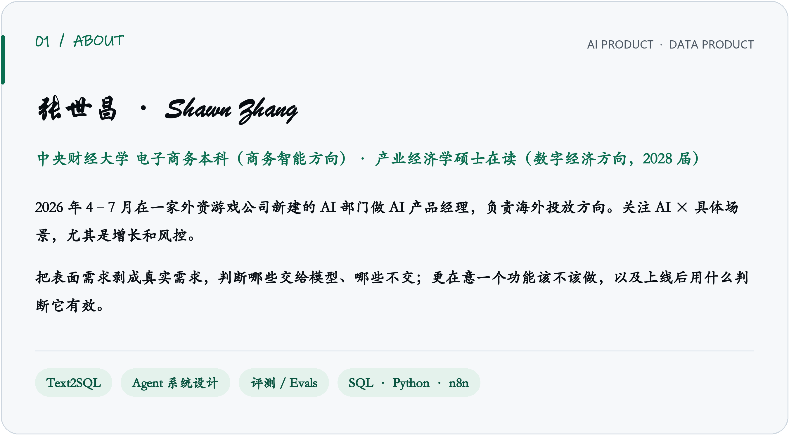
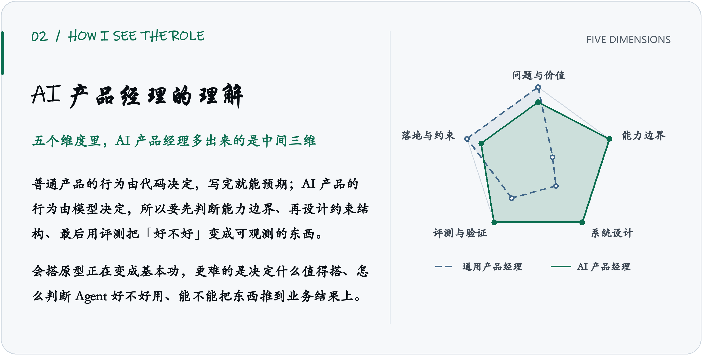
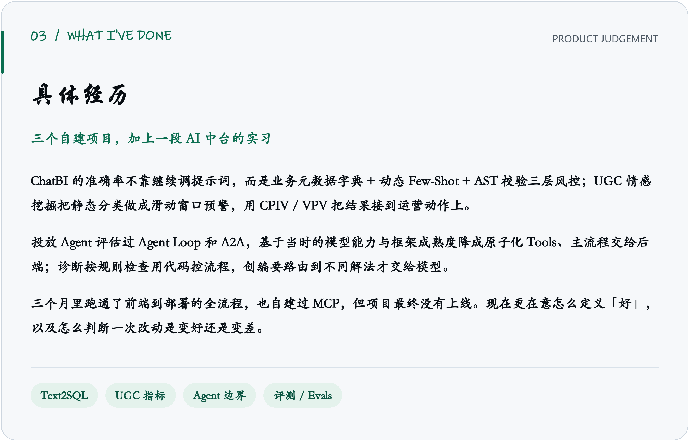

<picture>
  <source media="(prefers-color-scheme: dark)" srcset="assets/block-01-dark.png">
  
</picture>

<picture>
  <source media="(prefers-color-scheme: dark)" srcset="assets/block-02-dark.png">
  
</picture>

<picture>
  <source media="(prefers-color-scheme: dark)" srcset="assets/block-03-dark.png">
  
</picture>

## 📦 开源技能仓库

三个给 AI agent 用的技能仓库，和上面的产品工作是两条线：

| 仓库 | 一句话 |
| --- | --- |
| [**academic-tikz**](https://github.com/Eastr5/academic-tikz) | 📐 论文级 TikZ / PGFPlots 绘图技能包，187 个模板全部真实编译过——编译不过的活该被删 |
| [**literature-access-skills**](https://github.com/Eastr5/literature-access-skills) | 📚 文献检索 → 按 DOI 批量下全文 → 进 Zotero，一条链跑通，不人肉搬运 |
| [**skill-router-v3**](https://github.com/Eastr5/skill-router-v3) | 🔀 给 AI coding agent 用的 MCP / Skill / Tool 路由器，跨 Trae / Claude / Cursor / VSCode |

## 🎵 平时

音乐、hiphop。平时也会把几家模型放在同一个任务上对比失败类型，这个习惯后来影响到我设计评测口径。

## 📫 联系

`zhangshawn123@gmail.com` · WeChat: `eastr5`

纯文本版（便于复制、检索与朗读）

央财产业经济学硕士在读（数字经济方向，2028 届），本科电子商务。现在做 AI 产品 / 数据产品方向，关注的是 AI × 具体场景，尤其是增长和风控。

2026 年 4–7 月在一家外资游戏公司新建的 AI 部门做 AI 产品经理，负责海外投放方向。我把这份工作理解成两件事：把表面需求剥成真实需求，以及判断哪些交给模型、哪些不交——动手搭东西是探边界的手段，不是目的。自己也从 0 到 1 做过 Text2SQL 取数产品和 UGC 商业价值指标体系。

写需求文档、定边界、设计评测口径的时间比写代码多。SQL / Python / n8n 是常用工具，但更在意一个功能该不该做、上线后用什么判断它有效；技术原理上更关心它能不能翻译成决策，比如质量、成本、延迟怎么权衡。

把产品经理的能力拆成五个维度后，通用产品经理和 AI 产品经理的差别主要在中间三维：能力边界、系统设计、评测与验证。普通产品的行为由代码决定，写完就能预期；AI 产品的行为由模型决定，所以要先判断边界、再设计约束结构、最后用评测把「好不好」变成可观测的东西。五个维度是问题与价值、能力边界、系统设计、评测与验证、落地与约束，判断链按「该不该做 → 能不能交给模型 → 怎么搭 → 怎么知道好不好 → 能不能长期跑」展开。雷达图是相对侧重的示意，不是能力测评或个人评分。

| 项目 | 要解决的问题 | 关键取舍 |
| --- | --- | --- |
| **ChatBI**（Text2SQL） | 中小商家做数据分析要依赖专业人员 | 准确率不能只靠 Prompt，所以做了业务元数据字典 + 动态 Few-Shot + AST 校验三层风控，而不是继续调提示词 |
| **UGC 情感挖掘** | 评论里的负面信号发现得太晚 | 把静态分类做成滑动时间窗口的预警，并自研 CPIV / VPV 指标，让结果能直接对应到运营动作 |
| **销售预测与库存预警** | 「断货」和「滞销」同时存在 | 用 WRMSSE 替代通用误差指标，让模型优化方向和财务风险对齐 |

2026 年 4–7 月，在一家外资游戏公司新建的 AI 部门做 AI 产品经理，业务线是海外投放。下面只写方法层面的判断，不涉及公司内部数据。

- **技术选型是一次边界判断。** 评估过 Agent Loop 和 A2A，基于当时的模型能力和框架成熟度，选择把 AI 降成原子化 Tools、主流程交给后端；诊断按规则检查用代码控流程，创编要路由到不同解法才交给模型。这是约束下的取舍，不是「AI 做不到」。
- **会搭原型正在变成基本功。** Cursor 这类工具把搭建门槛降给了所有人，更难的是决定什么值得搭、怎么判断 Agent 好不好用、能不能把东西推到业务结果上。
- **Prompt 是产品契约。** 输入数据契约、输出格式、枚举含义、异常边界、执行前自检，这一层和写 PRD 是同一件事；领域知识再拆成按场景加载的 Skills，避免把所有规则塞进一条长提示词。
- **怎么定义「好」。** 建测试集、判断一次改动是变好还是变差，是 AI 产品和普通产品最不一样的地方。我现在更愿意把精力放在这上面，而不是多搭一个原型。
- **边界要写进文档。** 系统负责生成方案，投手是 Operator；三个月里跑通了从前端、API、后端到部署的全流程，也自建过 MCP 接两个数据源，但项目最终没有上线。对外演示不暗示「一键上量」。

另一条线是面向海外用户的分层行为标签体系：拉了算法、产品、数据三方同学共建，业务上涉及身份核验与风控场景；以及向数据科学团队提归因需求时，先给分层框架和参考 SQL，而不是只丢一个问题过去。

